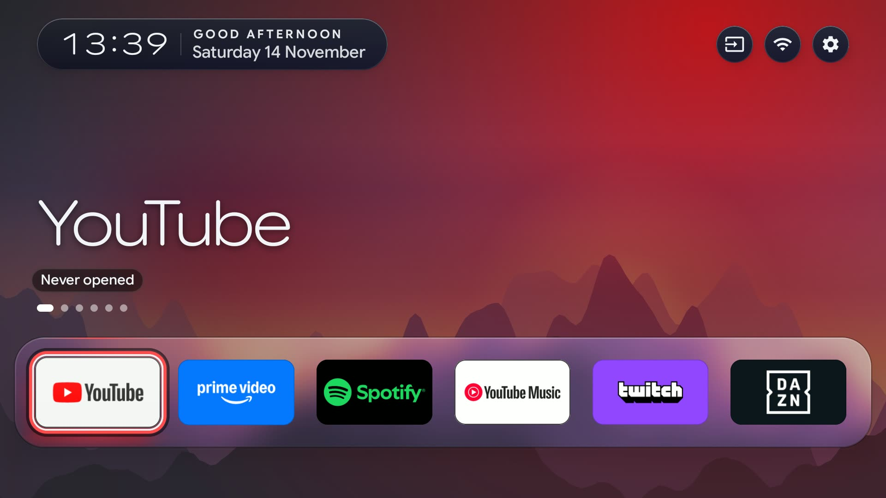
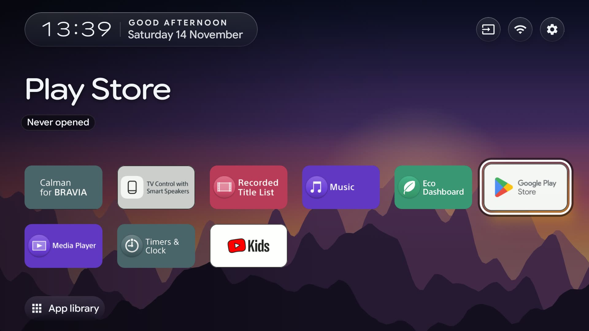
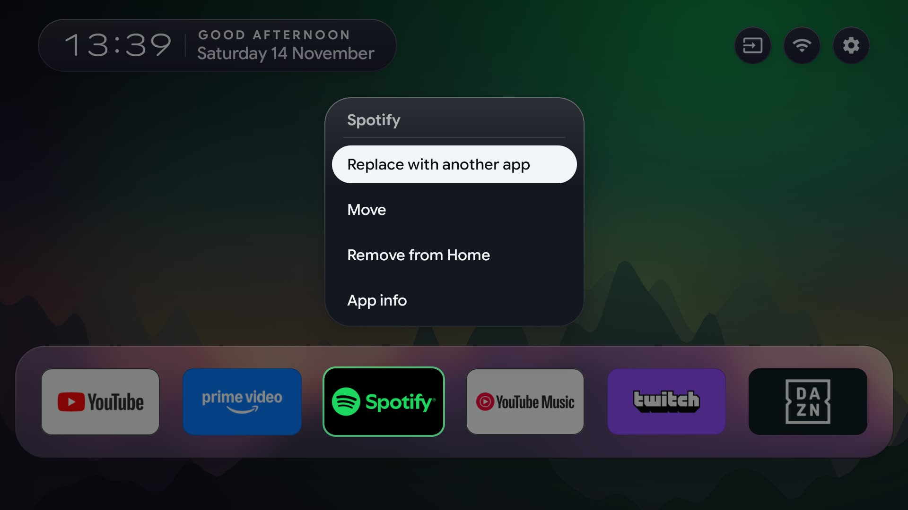
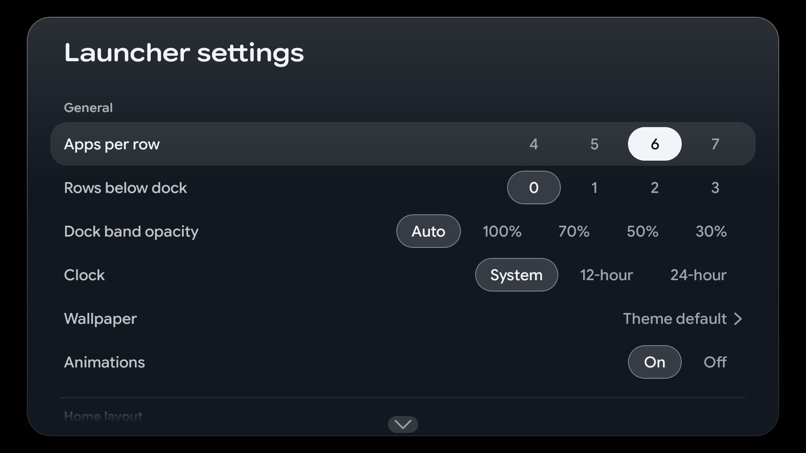

# cleanyourtv, with TV Home

This repository is a fork of [Gathin23/cleanyourtv](https://github.com/Gathin23/cleanyourtv). It keeps everything from
upstream and adds TV Home, a second launcher for Android TV and Google TV written in Kotlin and Jetpack Compose.

## What upstream is

cleanyourtv cleans up an Android or Google TV over Wi-Fi. An AI coding agent follows
[PROMPT.md](/PROMPT.md): it backs up the TV, turns off the preinstalled apps you do not want (disables them, never
uninstalls them), and installs a simple home screen. `tools/restore.sh` undoes every step. The upstream
[README](/README.md) explains the whole flow, the tested TV models and the tools. All of it works the same in this fork,
and the fork merges upstream's changes regularly.

The home screen that upstream installs is a Java launcher, in [`launcher/`](/launcher/), package `com.gathin.tvhome`.

## What this fork adds

TV Home is a rewrite of that home screen, in [`launcher-compose/`](/launcher-compose/), package `dev.niltsiar.tvhome`.
It installs beside the Java launcher, and a script switches which one is Home. So far it is tested on one TV, a Sony
Bravia with Android TV 12.

The difference is the code, not the goal:

| | Upstream launcher | TV Home |
|---|---|---|
| Language | Java | Kotlin |
| UI | Android Views | Jetpack Compose |
| Structure | One app module | Feature, data, core and service modules, with [Molecule](https://github.com/cashapp/molecule) presenters and [Metro](https://github.com/ZacSweers/metro) dependency injection |
| Network | No `INTERNET` permission | No `INTERNET` permission yet; a future feature may add it, off by default |
| Minimum Android | 8.0 (API 26) | 8.0 (API 26) |

Themes written for the Java launcher load in TV Home without changes: it reads the same `config.json` keys with the
same meaning. A few defaults differ, so a theme can look slightly different. For example, a tile that takes focus does not
bounce past its final size unless the theme sets `focus_overshoot`. [ADR 0003](/launcher-compose/docs/adr/0003-theme-keys-and-the-original-launcher.md)
lists every difference and every key TV Home adds.

TV Home has a Launcher settings page on the TV with 13 options that the Java launcher's page does not offer. Each new
feature is off until a theme or that page turns it on, for example:

- an App library page with every installed app, and an option to show least used apps first;
- a clock screen after a set idle time, or from the Back key;
- a mark under the app you usually open at this time of day;
- a notice when you connect a device to an HDMI port while Home shows.

The remote's Home, Input, Settings and app keys go through one accessibility service, which the install script below
turns on ([ADR 0001](/launcher-compose/docs/adr/0001-one-key-service.md)).

## Screenshots

These come from a Sony Bravia, with the launcher's English text.

| Home | App library |
|---|---|
|  |  |

| Tile menu | Launcher settings |
|---|---|
|  |  |

## Build and install TV Home

You need JDK 21, the Android SDK and ADB access to the TV (the upstream [PROMPT.md](/PROMPT.md) sets that up).

```bash
cd launcher-compose
./gradlew :app:assembleRelease
adb -s <tv ip>:5555 install -r app/build/outputs/apk/release/app-release.apk
TV_SERIAL=<tv ip>:5555 scripts/switch-home.sh new
```

`switch-home.sh new` makes TV Home the TV's Home, and `scripts/switch-home.sh old` makes the Java launcher Home again. Read the first lines of the script for its options
before you run it.

To push a theme to TV Home, run upstream's theme tool from the repository root with the package name:
`TV_PACKAGE=dev.niltsiar.tvhome TV_HOST=<tv ip> tools/theme.sh themes/aurora`.

## Credit and licence

The debloat tools, the themes and the Java launcher are the work of the upstream project and its contributors. TV Home
is new Kotlin code, written to match that launcher's features and theme keys. Both are under the [MIT licence](/LICENSE). Third-party pictures in
`launcher-compose/` keep their own licences, listed in
[launcher-compose/CREDITS.md](/launcher-compose/CREDITS.md).
