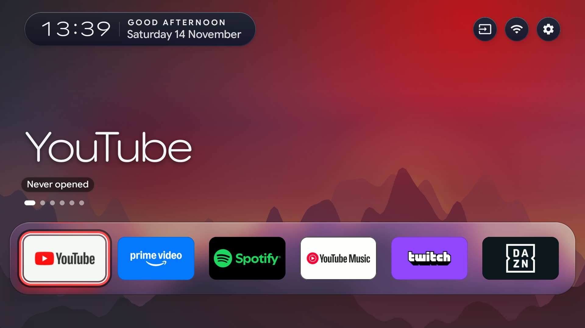
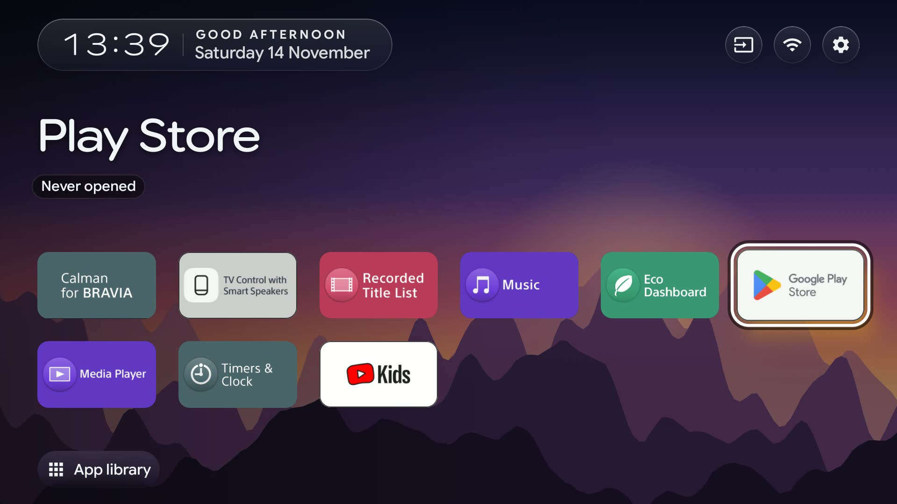
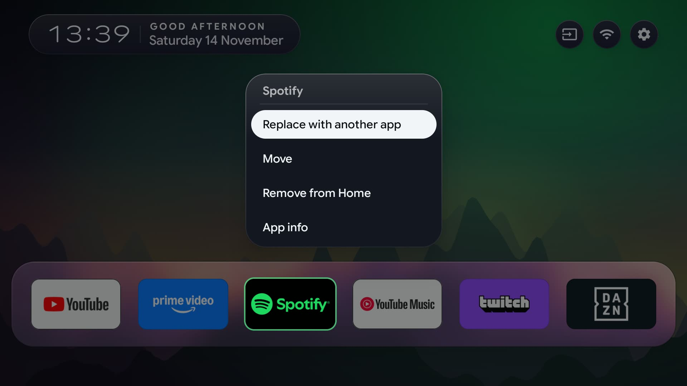
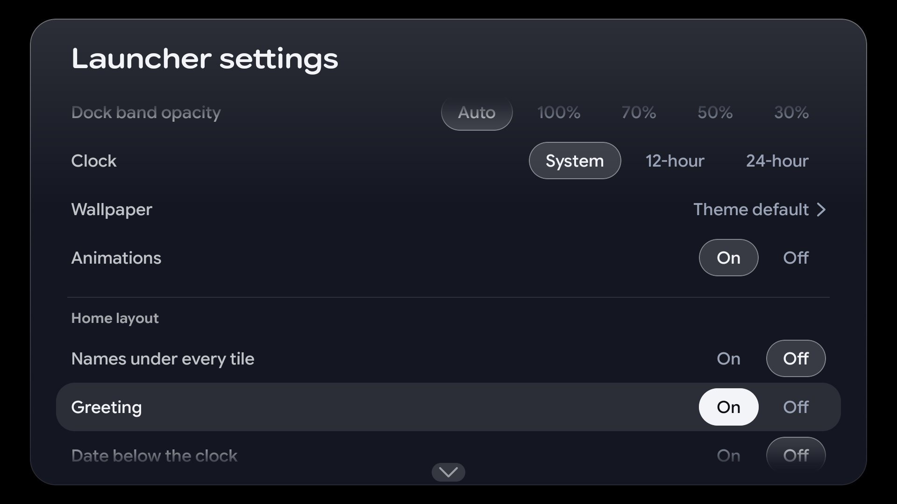
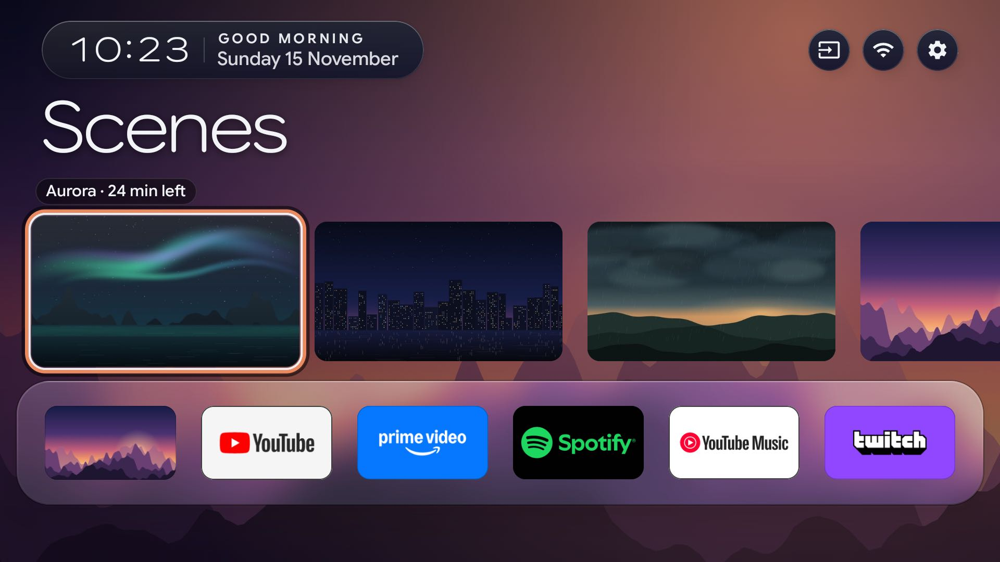
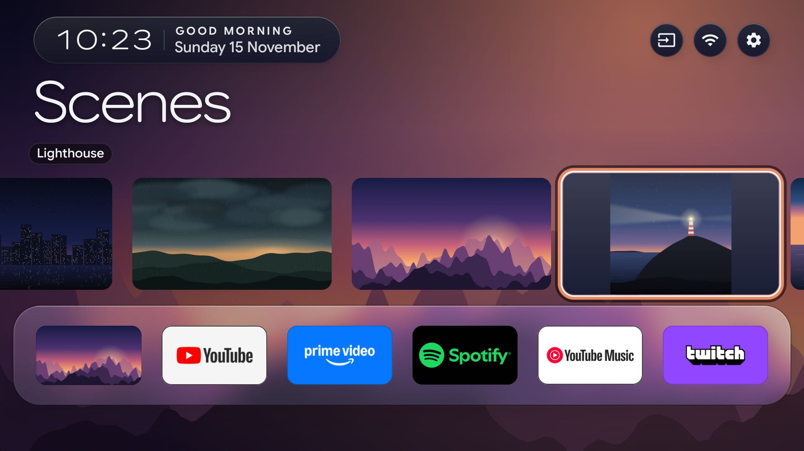

# cleanyourtv, with TV Home

This repository is a fork of [Gathin23/cleanyourtv](https://github.com/Gathin23/cleanyourtv). It keeps everything from
upstream and adds TV Home, a second launcher for Android TV and Google TV written in Kotlin and Jetpack Compose.

## What upstream is

cleanyourtv cleans up an Android or Google TV over Wi-Fi. An AI coding agent follows
[PROMPT.md](/PROMPT.md): it backs up the TV, turns off the preinstalled apps you do not want (disables them, never
uninstalls them), and installs a simple home screen. `tools/restore.sh` undoes every step. The upstream
[README](/README.md) explains the whole flow, the tested TV models and the tools. All of it works the same in this fork,
and the fork merges upstream's changes regularly.

The home screen that upstream installs is a Java launcher, in [`launcher/`](/launcher/), package `com.gathin.tvhome`.

## What this fork adds

TV Home is a rewrite of that home screen, in [`launcher-compose/`](/launcher-compose/), package `dev.niltsiar.tvhome`.
It installs beside the Java launcher, and a script switches which one is Home. So far it is tested on one TV, a Sony
Bravia with Android TV 12.

| | Upstream launcher | TV Home |
|---|---|---|
| Language | Java | Kotlin |
| UI | Android Views | Jetpack Compose |
| Structure | One app module | Feature, data, core and service modules, with [Molecule](https://github.com/cashapp/molecule) presenters and [Metro](https://github.com/ZacSweers/metro) dependency injection |
| Network | No `INTERNET` permission | No `INTERNET` permission. An optional helper app, whose only permission is `INTERNET`, fetches poster pictures for it ([below](#the-poster-helper)) |
| Minimum Android | 8.0 (API 26) | 8.0 (API 26) |

Themes written for the Java launcher load in TV Home without changes: it reads the same `config.json` keys with the
same meaning, the cinematic Home (`cinematic_home`) included. A few defaults differ, so a theme can look slightly
different. For example, a tile that takes focus does not bounce past its final size unless the theme sets
`focus_overshoot`. TV Home also adds theme keys of its own, such as the light that the focused dock tile casts on the
dock's rim. [ADR 0003](/launcher-compose/docs/adr/0003-theme-keys-and-the-original-launcher.md) lists every difference
and every key TV Home adds.

The remote's Home, Input, Settings and app keys go through one accessibility service, which the install script below
turns on ([ADR 0001](/launcher-compose/docs/adr/0001-one-key-service.md)).

The standby guard is for a TV whose power key cannot wake the set while the key service stays on with the screen off
(seen on a TCL). It is off by default. No theme key or setting turns it on: only `GUARD=1 scripts/switch-home.sh new`
does. While the guard is on, the key service leaves Android's accessibility list when the screen goes off and comes back
when the screen comes on. So turning the key service off in the TV's settings does not stick: TV Home puts it back the
next time it starts, such as after a reboot. `scripts/switch-home.sh old` turns the guard off.

### Launcher settings

TV Home has a Launcher settings page on the TV. To open it, hold OK on the Settings button of the top bar and pick
Launcher settings. A choice that you make on the page wins over the theme's. The next theme push clears every such
choice except Open on start.

The General group has the rows that the Java launcher's page has too: apps per row, rows below the dock, the dock band's
opacity, the clock format and animations, then Wallpaper and Open on start when the theme offers them. The groups below
are TV Home's own. Every option in them stays off until a theme or the page turns it on. Greeting is the one exception:
it starts on.

Home layout:

- **Names under every tile.** Each app's name shows under its tile, in the dock and in the grid.
- **Greeting.** The greeting shows with the clock.
- **Date below the clock.** The date gets its own line under the clock.
- **Quick move in tile menu.** The tile menu gets a Move to row, which puts the app at the start or the end of the dock
  or the grid in one step.
- **App highlights.** When a dock app keeps focus, cards of that app's own items show above the dock, from its Continue
  watching row and its preview channels. OK on a card opens it. The Apps and channels row picks which apps and channels
  give cards. For this, Home reads the TV's program listings, which needs the `READ_TV_LISTINGS` permission.
- **Cards per app.** App highlights shows up to 5, 10 or 20 cards for each app. 10 is the default.
- **Pictures from the web.** App highlights cards show their poster pictures from the web, which the poster helper app
  fetches. Without the helper, such a card shows text on the app's banner.
- **Pictures from your network.** With Pictures from the web on, App highlights cards also show poster pictures from a
  media server on your home network.
- **Now playing.** What a dock app plays, such as a Spotify track, is the first card of its App highlights, with the
  title, the artist and Paused, and it changes with the track. OK opens the app. Home reads the app's media session,
  which needs notification access for TV Home's Now playing entry. Home reads no notification. Where the TV has no
  Notification access screen, the row gives the adb line that allows it.

App library:

- **Show App library.** An App library pill under Home's rows opens a page with every installed app, where you add an app
  to Home or take it off.
- **Least used first.** The MENU key in the App library switches to an order with the least used apps first, and each
  card says when Home last opened its app.
- **Fade unused apps after (days).** A grid tile looks faded when Home has not opened its app for 30, 60 or 90 days.

Clock screen:

- **Clock after idle (minutes).** When nobody touches Home for 5, 10, 30 or 60 minutes, a clock screensaver shows. Any
  key goes back to Home.
- **Back opens the clock.** Back on Home opens the clock screensaver.
- **Wallpaper behind the clock.** The clock screensaver shows over Home's wallpaper, not over black.

Motion and hints:

- **Reduced motion.** Animations are calmer and shorter, for TVs with a weak graphics chip.
- **Focus overshoot.** A tile that takes focus grows a little past its size, then settles.
- **Press feedback.** OK on a tile dips it and brightens its ring. When the app is slow to start, the line under the title
  says that it is opening.
- **Habit hint.** A small mark shows under the app that you usually open at this time of day. For this, Home keeps a
  private log of the apps it opens. With the option off, Home logs nothing.
- **Start on the usual app.** With Habit hint on, focus starts on the usual app's tile when the TV starts and when you
  press Home in an app. A key pressed before Home finds that app keeps focus where you put it. Waking the TV, Back from
  an app and Home pressed on Home never move focus to it.
- **Input arrival.** When you switch on a device on an HDMI port while Home shows, the Inputs button names the device and
  its port. OK on the button switches to that input. Home never switches input by itself.
- **Input tiles.** Hold OK on an HDMI or AV row of the Inputs list and pick Add to Home: the input gets a tile at the end of
  the grid, which you can move into the dock like an app. The tile shows the device's name and a dot when the TV tells
  whether a device is connected, and OK on it switches to that input. Hold OK on the row again, or use the tile's menu, to
  remove it.

System:

- **Restart TV from Home.** Restart TV in the Settings button's menu asks on Home first, with Cancel focused. Restart then
  presses Restart in the TV's own power menu for you, for TVs where the remote cannot move in that menu. Where Home
  cannot find that Restart item, it presses nothing, closes the menu and says so.

The System group also resets the page's choices to the theme's, opens the TV's home picker and opens the TV's own
settings.

### The poster helper

TV Home has no `INTERNET` permission. The poster helper is a separate, optional app, package
`dev.niltsiar.tvhome.posters`, whose only permission is `INTERNET`. When Pictures from the web is on, Home sends it the
poster addresses of the cards about to show, and the helper fetches those pictures. It fetches `https` pictures only from
hosts whose addresses are all public. It fetches pictures from private addresses on your home network, over `http` or
`https`, only when Pictures from your network is on too. Home sends addresses only to a helper signed with Home's own
key, so build both on the same machine. [companion/posters/README.md](/launcher-compose/companion/posters/README.md) gives
its full rules and limits.

## Screenshots

These come from a Sony Bravia, with the launcher's English text.
The App highlights cards come from a small test app that publishes the repository's own scene pictures, so no
household's viewing shows.

| Home | App library |
|---|---|
|  |  |

| Tile menu | Launcher settings |
|---|---|
|  |  |

| App highlights | A square picture |
|---|---|
|  |  |

## Build and install TV Home

You need JDK 21, the Android SDK and ADB access to the TV (the upstream [PROMPT.md](/PROMPT.md) sets that up).

Build and install TV Home, push a theme to it, then make it Home:

```bash
cd launcher-compose
./gradlew :app:assembleRelease
adb -s <tv ip>:5555 install -r app/build/outputs/apk/release/app-release.apk
cd ..
TV_PACKAGE=dev.niltsiar.tvhome TV_HOST=<tv ip> tools/theme.sh themes/aurora
cd launcher-compose
TV_SERIAL=<tv ip>:5555 scripts/switch-home.sh new
```

`switch-home.sh new` changes nothing until TV Home has a theme, because the theme holds the remote's key remaps.
It makes TV Home the TV's Home, and grants the permissions that the Wi-Fi name and App highlights need.
`scripts/switch-home.sh old` makes the Java launcher Home again. Read the first lines of the script for its options
before you run it. To push another theme, run the `tools/theme.sh` line again from the repository root.

Optional: for App highlights posters from the web, build and install the poster helper in `launcher-compose`. Build it
in the same checkout, on the same machine, as TV Home: Home sends poster addresses only to a helper signed with its own
key, and a helper signed with another key does not install next to it.

```bash
./gradlew :companion:posters:assembleRelease
adb -s <tv ip>:5555 install -r companion/posters/build/outputs/apk/release/posters-release.apk
```

## Credit and licence

The debloat tools, the themes and the Java launcher are the work of the upstream project and its contributors. TV Home
is new Kotlin code, written to match that launcher's features and theme keys. Both are under the [MIT licence](/LICENSE). Third-party pictures in
`launcher-compose/` keep their own licences, listed in
[launcher-compose/CREDITS.md](/launcher-compose/CREDITS.md).
